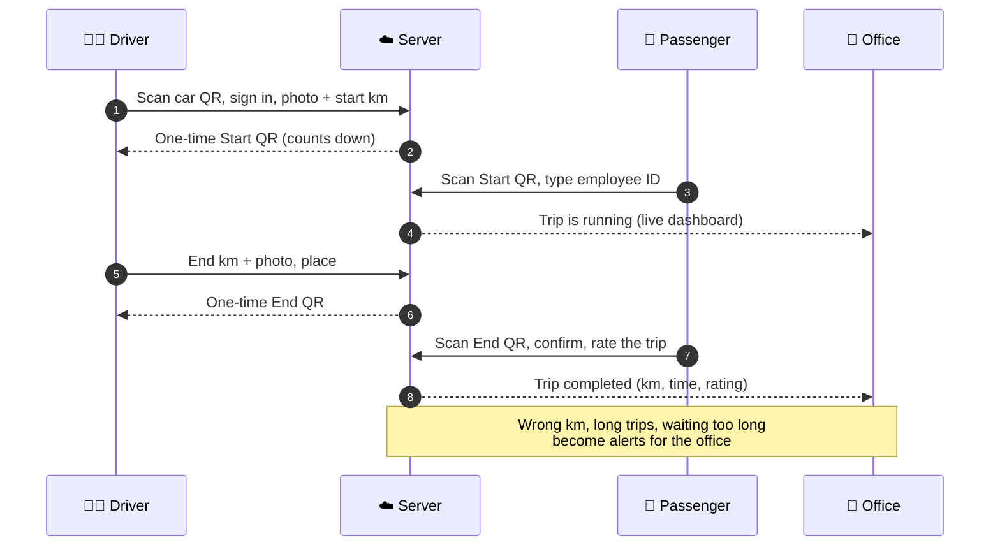

<div align="center">

# 🚗 Scan-to-Drive

**Company car trip logging with one QR scan.**
The driver scans the sticker in the car, the passenger confirms on their own phone, the transport office sees everything live.


Built for **Epic Group**, Bangladesh &nbsp;

[What it does](#-what-it-does) · [How a trip works](#-how-a-trip-works) · [What is done](#-what-is-done) · [QR codes and the network](#-qr-codes-and-the-network-read-this-when-the-address-changes) · [Run it](#-run-it) · [Next](#-whats-next)

</div>

---

## ✨ What it does

Epic Group has 24 cars (14 Epic-owned, 10 rented from the vendor Lanka Bangla). Before this, trips were written in a form. Now:

| Who | What they do | Where |
|---|---|---|
| 🧑‍✈️ **Driver** | Scans the QR sticker in the car, signs in with employee ID and PIN, takes a photo of the dashboard, enters the km, starts the trip. Ends it the same way. | Phone browser, nothing to install |
| 🙋 **Passenger** | Scans the driver's one-time QR and types their 7-digit employee ID to confirm the start, and again at the end. Can rate the trip. | Their own phone |
| 🏢 **Transport office** | Live dashboard, trip history with photos, alerts, reports, cars and drivers, users and settings. | Browser, English or বাংলা, light or dark |

No app to install: it's a website that works like an app on the phone (the camera scanner, GPS and keeping the screen on need https, see the [QR section](#-qr-codes-and-the-network-read-this-when-the-address-changes)).

## 🔁 How a trip works



Trips without a passenger are allowed (with a purpose). If a passenger cannot scan, the driver skips the confirmation and the office approves it later.

## ✅ What is done

**Phase 1 is complete** (steps 1 to 9 of the plan), plus changes after the real data arrived.

<table>
<tr>
<td width="50%" valign="top">

### 🧑‍✈️ Driver and 🙋 passenger side
- QR sticker per car, new sticker on demand
- Driver sign-in with PIN, sessions in cookies
- Start and end forms with dashboard photos, in-app QR scanner
- One-time QR with countdown, wrong-ID limit, visitor trips
- "Passenger can't scan" with later approval by the office
- Trips without passenger, one-tap end, 1 to 5 star ratings
- Photos cleaned and stored the same way (ready for reading the km later)

</td>
<td width="50%" valign="top">

### 🏢 Office side
- Live dashboard: clickable numbers, latest four cars, alerts, ratings, trips running now, "this month at a glance"
- Trip history with filters and a full trip page (photos, timeline)
- **Cars**: Epic cars and vendor cars as two views, vendors renamable and addable
- Drivers, passengers (Excel import), users (admin or viewer), settings
- **Reports**: 7 reports with filters, Excel and PDF
- Alerts that check every minute (km gap, long trip, waiting too long, wrong IDs, high km)
- Hidden page to **import old trips** from the paper-form exports, with undo

</td>
</tr>
</table>

### 📊 In numbers

| | |
|---|---|
| API endpoints | **72** (5 sign-in, 49 office, 18 driver / passenger / system) |
| Backend tests | **336** passing |
| Database | 8 migrations; `trip_events` is append-only (the audit trail cannot be edited) |
| Languages | English and Bangla (every screen) |
| Look | Light and dark, phone dock, opening screen, animated dashboard |

### 🗂 The seven reports

`Monthly summary` · `Car usage` · `Drivers` · `Passengers & departments` · `Exceptions` · `Km continuity` · `Trip log`
Filters: dates (today, week, month, last month, custom), car, driver, department. Download as Excel or PDF.

### 🔐 Rules the app keeps

- Times are stored in UTC and shown in Bangladesh time (UTC+6), always from the server clock.
- Raw QR tokens, PINs and passwords are never stored, only hashes.
- Employee and driver IDs are **7 digits** (drivers `1239xxx`, employees `1236xxx`).
- Every important action is written to the audit log.

---

## 📱 QR codes and the network (read this when the address changes)

Every car sticker holds one link: **`PUBLIC_BASE_URL` + `/c/<car code>?v=<version>`**, for example `https://192.168.0.103:3000/c/CAR-07?v=1`.
So the QR contains the address the app is running on. That has two consequences.

### Testing on a laptop (the address changes)

At home or in the office the laptop's address (`192.168.0.x`) can change every time it reconnects to the Wi-Fi. When it does:

1. Run `npm run dev:lan:https` again. It prints the **new** address and a QR code, and makes a new certificate.
2. In `backend/.env` set the new address and **restart the backend**:
   ```
   PUBLIC_BASE_URL=https://192.168.0.103:3000
   ```
3. **Print or show the car stickers again** (Cars page, or `GET /api/admin/cars/{id}/qr.pdf`). Stickers made before still hold the old address and will not open.
4. On each phone open the new address once and accept the certificate warning again.

> 💡 You do **not** need "New QR" for this. "New QR" changes the version number and switches the old sticker off on purpose (for a lost or damaged sticker). An address change only needs the sticker printed again.

### For real use (stickers must never change)

A sticker glued in a car should outlive any laptop. Before printing the real stickers:

- Put the app on a server with a **fixed address or, better, a domain name** (for example `https://trips.epic-group.example`), with a proper certificate.
- Set `PUBLIC_BASE_URL` to that name **before** printing.
- On a home or office network, if you must use the laptop, ask for a **fixed (reserved) address** for it in the router (DHCP reservation).

### Phone cannot open the page?

| What you see | Usual reason | Fix |
|---|---|---|
| `ERR_ADDRESS_UNREACHABLE` | Phone and laptop are not on the same network or band | Same Wi-Fi, same band (a laptop on 5 GHz was not reachable from phones on 2.4 GHz on one router). Turn off VPN and mobile data on the phone |
| Page loads but camera / GPS do not work | Plain `http://` | Use `npm run dev:lan:https` (browsers allow the camera and GPS only on https) |
| Timeout | Windows firewall or guest Wi-Fi | Set the Wi-Fi to **Private**; allow Node.js on Private networks |
| "Your connection is not private" | Test certificate made on the laptop | Android: **Advanced → Proceed**. iPhone: **Show Details → visit this website** |
| QR opens the old address | Sticker made before the address changed | Print the sticker again (see above) |

Quick test: open `https://<address>:3000/api/health` on the phone. A reply means the network is fine.

If the firewall rule is missing, in PowerShell **as administrator**:
```powershell
New-NetFirewallRule -DisplayName "Scan-to-Drive 3000" -Direction Inbound -Protocol TCP -LocalPort 3000 -Action Allow -Profile Private,Public
```

---

## 🛠 Run it

**You need:** Windows with PowerShell, Python (3.12 or newer), Node.js 22 LTS, PostgreSQL 16.
All Python commands go through `python -m ...` (the company laptop blocks the `.exe` launchers).

### 1. Backend (`backend/`)

```powershell
.\.venv\Scripts\Activate.ps1
copy .env.example .env             # first time: edit DATABASE_URL and SECRET_KEY
python -m alembic upgrade head     # create / update the tables (migrations 0001 to 0008)
python -m app.seed                 # new empty database only: settings, admin and viewer, the real fleet
python -m uvicorn app.main:app --reload --host 127.0.0.1 --port 8000
python -m app.worker               # second window: background alert checks (run only one)
python -m pytest -q                # 336 tests
```

API docs (Swagger): <http://127.0.0.1:8000/api/docs>

> ⚠️ **Migrations only change the structure of the database, not its data.** After upgrading, the real fleet is loaded by a separate script:
> `python -m app.load_fleet` (dry run) then `python -m app.load_fleet --apply`. `--apply` removes the test data first.
> Do this **before** importing old trips, because the import matches cars by number plate.

### 2. Frontend (`frontend/`)

```powershell
npm ci                       # first time
copy .env.example .env.local # BACKEND_URL=http://127.0.0.1:8000
npm run dev                  # this laptop only: http://localhost:3000
npm run dev:lan:https        # for phones on the same Wi-Fi (prints the address and a QR code)
npm run build                # the production build
```

### 3. Useful commands

| Do this | Command |
|---|---|
| Change an admin password | `python -m app.set_password admin` |
| Create a viewer | `python -m app.set_password mary --create --role viewer` |
| New migration after changing models | `python -m alembic revision --autogenerate -m "message"`, then review it |
| Import old form trips | Open `/admin/import` as an admin (not in the menu), drop the two CSV files |

`backend/.env` keys: `DATABASE_URL`, `SECRET_KEY`, `ENVIRONMENT`, `PUBLIC_BASE_URL`, `CORS_ORIGINS`, `STORAGE_DIR`, `MAX_PHOTO_MB`, `PDF_FONT_PATH`. The full list is in the [project log](docs/PROJECT_LOG.md#how-to-run-from-backend-powershell).

---

## 🧱 Built with

| Part | Tech |
|---|---|
| Frontend | Next.js 16 (App Router), React 19, Tailwind 4, motion, next-intl, Phosphor icons |
| Backend | FastAPI, SQLAlchemy 2, Alembic, Pydantic, APScheduler |
| Database | PostgreSQL 16 (append-only audit trigger) |
| Files | Pillow (photo cleaning), ReportLab (PDF), openpyxl (Excel), qrcode (stickers) |
| Planned hosting | One Ubuntu VM on company Azure with Docker Compose (Nginx, Next.js, FastAPI, PostgreSQL, worker) and Azure Blob Storage for photos |

```
scan-to-drive-webapp/
├─ backend/    FastAPI app, models, migrations, services, 336 tests
├─ frontend/   Next.js app (driver, passenger and office screens), messages in en.json / bn.json
└─ docs/       Project plan (PDF), project log, passenger import template
```

## 🔭 What's next

- [ ] Verify the last items on the laptop and phones over https, then load the real fleet and print the stickers
- [ ] Docker and Azure: containers, Blob Storage for photos, production settings, a real certificate and domain
- [ ] Pages still hidden in the menu: Passengers, Audit log, Driver overtime
- [ ] Read the km from the dashboard photo (OCR); photos are already stored for it
- [ ] A Bangla font for the PDF reports
- [ ] From Epic: real driver IDs and phones, Epic car models, the employee list

## 📚 More

- 📓 **[docs/PROJECT_LOG.md](docs/PROJECT_LOG.md)**: the full build log, every step with how it was checked, the database notes, the API list and the repo layout
- 📄 `docs/Scan-to-Drive_Phase_One_Project_Plan.pdf`: the plan this follows (v1.0, 5 Oct 2026)

<div align="center"><sub>Epic Group · Relentless pursuit of better</sub></div>
